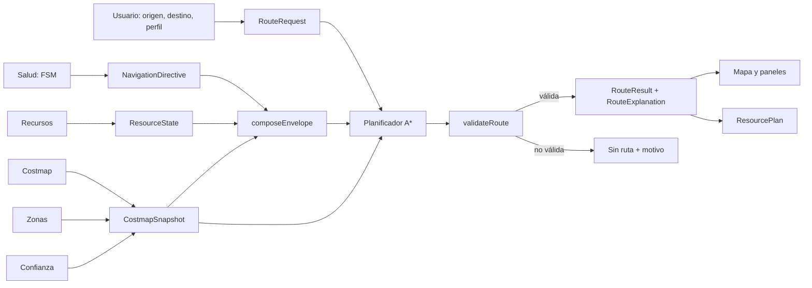
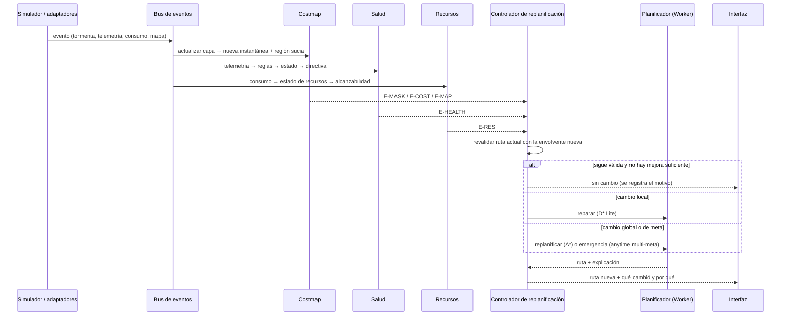

# ARCHITECTURE — Arquitectura del sistema Mars Trek

> Fase: PLANNING · Estado: propuesta para aprobación · Fecha: 2026-11-14
> Documento maestro: [MARS_TREK_MASTER_PLAN.md](../MARS_TREK_MASTER_PLAN.md) · Relacionados: todos los de `docs/`

---

## 1. Principios

Se heredan los cinco principios que ya rigen el repositorio (`docs/TECHNICAL_ARCHITECTURE.md` del proyecto principal) y se añaden tres.

| # | Principio | Origen |
| --- | --- | --- |
| 1 | **Evolucionar, no reemplazar.** La aplicación TanStack Start, sus rutas y sus componentes se conservan | Heredado |
| 2 | **Una misión, una fuente de verdad.** El estado compartido vive en un store | Heredado |
| 3 | **Núcleo determinista; IA opcional.** Los modelos y el motor son funciones puras; un modelo de lenguaje puede explicar, nunca decidir | Heredado |
| 4 | **Procedencia en todo.** `REAL`, `DERIVED`, `MODELLED`, `SIMULATED` | Heredado |
| 5 | **Funciona sin red; se refresca con red.** Instantáneas con fecha | Heredado |
| 6 | **Seguridad por construcción.** El motor de rutas no puede recibir una petición sin envolvente de seguridad | Nuevo |
| 7 | **Contratos primero.** Los módulos se comunican por tipos acordados antes de implementar | Nuevo |
| 8 | **La simulación entra por la misma puerta que los datos reales** y conserva su etiqueta hasta la interfaz | Nuevo |

---

## 2. Dónde encaja Mars Trek

Mars Trek es un **módulo nuevo dentro de la aplicación existente** (MARS // SURVIVE, en `Nasa-Space-App-challange-2026/`), no una aplicación aparte.

```
┌──────────────────────── Aplicación existente (TanStack Start · React 19 · Vite) ─────────────────────────┐
│  Overview · Explorer · Atlas · Planner · Simulator · Decisions · NASA Data · Reports · (referencia)       │
│                                                                                                            │
│  ┌──────────────────────────────── NUEVO: Mars Trek ────────────────────────────────┐                     │
│  │  /trek  ── mapa, capas, perfiles, comparación, simulación, replanificación        │                     │
│  │  src/core/trek/  ── costmap · costo · rutas · salud · recursos · confianza · zonas │                     │
│  └────────────────────────────────────────────────────────────────────────────────────┘                     │
│                                                                                                            │
│  Núcleo existente: src/core/science (geo, terrain, environment, marsTime, eva, routing) · src/core/sim     │
│  Servicios existentes: src/services/nasa (adaptadores) · src/services/atlas (rásteres)                     │
│  Estado existente: src/state/missionStore.ts                                                               │
└────────────────────────────────────────────────────────────────────────────────────────────────────────────┘
        ▲                                   ▲                                         ▲
        │                                   │                                         │
 metricas de vida/ (HUELLA, Python)   access-mars/ (recursos 3D)        Nasa/ (sitio Space Rockstars)
 referencia para portar a TS          ya copiados a public/eva/         presentación; sección MarsWalk
```

El resto de carpetas del espacio de trabajo se tratan así:

| Carpeta | Papel | Qué se hace |
| --- | --- | --- |
| `Nasa-Space-App-challange-2026/` | Aplicación principal | Aquí se construye Mars Trek |
| `metricas de vida/` | Motor de salud HUELLA en Python y datos sintéticos | Referencia y pruebas de paridad. No se modifica |
| `access-mars/` | Copia del proyecto de Google Creative Lab | Fuente de recursos. No se modifica |
| `Nasa/` | Sitio estático "Space Rockstars" con la sección MarsWalk en desarrollo | Presentación. Puede enlazar a Mars Trek; integración por decidir (P-03) |
| `Auditoría Técnica Mars Trek…/` | Informe y cuadernos | Fuente de investigación |
| `server.js`, `server.py`, `start-server.command` | Servidores estáticos locales | Sin cambios |

---

## 3. Módulos

Los quince módulos pedidos, con su ubicación propuesta y su responsable (agentes en AGENT_GUIDELINES).

| # | Módulo | Responsabilidad | Ubicación | Reutiliza | Agente |
| --- | --- | --- | --- | --- | --- |
| M01 | Frontend y mapa interactivo | Pantalla `/trek`, paneles, comparación, explicación | `src/routes/trek.tsx`, `src/components/trek/` | `AppShell`, kit `mission/ui.tsx`, shadcn | A6 |
| M02 | Motor cartográfico | Mapa 2D y escena 3D local | `src/components/trek/map/` | `AtlasMap.tsx` (Leaflet), `SurfaceEva.tsx` y `Globe.tsx` (R3F) | A6 con A1 |
| M03 | Sistema de capas geoespaciales | Catálogo de capas con leyenda, unidad, fuente y procedencia | `src/core/trek/costmap/layers.ts` | `src/data/layers.ts` | A1 |
| M04 | Procesamiento de datasets | Descarga, recorte, reproyección, derivados, manifiestos | `scripts/trek/` (fuera de línea) | `scripts/fetch-nasa-data.ts`, `services/nasa/transform.ts` | A2 |
| M05 | Costmap multicapa | Teselas, instantáneas, versiones, regiones sucias | `src/core/trek/costmap/` | `HeightGrid`, `TerrainGrid` | A1 |
| M06 | Motor A\* | Búsqueda óptima multicapa | `src/core/trek/routing/astar.ts` | Montículo y suavizado de `routing.ts` | A3 |
| M07 | Replanificación dinámica | Controlador de eventos, D\* Lite, búsqueda anytime | `src/core/trek/routing/` | — | A3 |
| M08 | Sistema de pesos dinámicos | Perfiles, multiplicadores, validación y renormalización | `src/core/trek/cost/` | Posturas de riesgo de `decision/criteria.ts` como patrón | A3 |
| M09 | Astronaut Health State Machine | Reglas, estados, directiva, equipo | `src/core/trek/health/` | HUELLA (port) | A4 |
| M10 | Gestión de recursos | Modelos de consumo, presupuestos, alcanzabilidad | `src/core/trek/resources/` | `eva.ts`, constantes BVAD | A5 |
| M11 | Riesgos y restricciones | Zonas, envolvente de seguridad, validación de rutas | `src/core/trek/zones/` (A1) y `src/core/trek/safety/` (A3) | Umbrales de `constants.ts` | A1 y A3 |
| M12 | Confianza científica | Clases K, puntuación, evidencia | `src/core/trek/confidence/` | `Provenance`, taxonomía de `marsMissionAtlas.ts` | A2 |
| M13 | Simulador de misiones | Reloj, guiones de escenario, inyección de eventos | `src/core/trek/sim/` | `src/core/rng.ts`, patrón de `core/sim` | A7 |
| M14 | Backend y APIs | Proxies y claves en servidor | `src/routes/api/` | Rutas `/api/nasa/*` existentes | A2 |
| M15 | Almacenamiento y caché | Teselas en IndexedDB, estado, instantáneas | `src/services/trek/storage/` | `missionStore` como patrón | A1 |
| — | Contratos compartidos | Tipos de todas las interfaces de §5 | `src/core/trek/contracts/` | `src/core/types.ts` | A7 |

Regla de dependencias: `src/core/trek/**` no importa React, el store ni la red. Dentro del núcleo, las dependencias permitidas son:

```
contracts ◄── todos
costmap   ◄── zones, confidence, routing, resources
resources ◄── health (solo variables derivadas), routing
health    ──► contracts (directiva)          health NO importa routing ni costmap
safety    ◄── routing                        safety importa: contracts, costmap, zones, resources
routing   ──► NO importa health (solo el tipo de la directiva, desde contracts)
```

---

## 4. Flujos

### 4.1 Planificación inicial



### 4.2 Replanificación por evento



### 4.3 Orden de evaluación en cada ciclo

Salud y recursos se necesitan mutuamente: la directiva de salud fija la velocidad que usa el modelo de consumo, y las reglas de salud usan los márgenes que calcula recursos. No es una dependencia circular de código (ambos dependen solo de `contracts/`), pero sí exige un orden fijo en cada ciclo de simulación:

1. **Costmap:** aplica los eventos de ambiente y publica la instantánea.
2. **Recursos:** actualiza el estado y los márgenes usando la **última directiva vigente**.
3. **Salud:** evalúa las reglas con la telemetría y con esos márgenes, y emite la directiva nueva si cambia.
4. **Seguridad:** compone la envolvente con la directiva nueva.
5. **Replanificación:** revalida la ruta y decide.
6. **Interfaz:** recibe un único estado coherente del ciclo.

Si la directiva cambia en el paso 3, los márgenes se recalculan una vez más antes del paso 4. No se itera más: el siguiente ciclo absorbe el resto.

---

## 5. Interfaces entre módulos

Todos los contratos viven en `src/core/trek/contracts/` y se congelan en el hito H1. Aquí se listan; su definición detallada está en el documento indicado.

| Contrato | Produce | Consume | Definido en |
| --- | --- | --- | --- |
| `LayerSpec`, `CostmapTile`, `CostmapSnapshot` | Costmap | Rutas, zonas, confianza, interfaz | DYNAMIC_COSTMAP §3 |
| `ZoneClass`, `ZoneRules` | Zonas | Envolvente, interfaz | DYNAMIC_COSTMAP §7 |
| `ConfidenceClass`, `Evidence`, `ConfidenceService` | Confianza | Costmap, rutas, interfaz | SCIENTIFIC_CONFIDENCE §7 |
| `NavigationDirective`, `HealthTransition` | Salud | Envolvente, interfaz, informes | ASTRONAUT_HEALTH_STATE_MACHINE §6–7 |
| `ResourceState`, `ResourcePlan`, `LocomotionModel`, `ReachabilityField` | Recursos | Salud, envolvente, rutas, interfaz | RESOURCE_MANAGEMENT §1, §7 |
| `SafetyEnvelope`, `composeEnvelope`, `validateRoute` | Seguridad | Rutas | ROUTING_ALGORITHM §5 |
| `WeightProfile`, `WeightVector` | Pesos | Rutas, interfaz | ROUTING_ALGORITHM §3.5 |
| `RouteRequest`, `RouteResult`, `RouteExplanation` | Rutas | Interfaz, recursos, informes | ROUTING_ALGORITHM §8 |
| `ReplanEvent`, `ReplanDecision` | Costmap, salud, recursos / controlador | Controlador / interfaz | ROUTING_ALGORITHM §6 |
| `ScenarioScript`, `MissionClock`, `SimEvent` | Simulador | Todos los productores de eventos | §8 de este documento |
| `TrekState`, `TrekAction` | Store | Interfaz | §7 de este documento |

Los tipos auxiliares que aparecen en los contratos sin detallar (`LocalPoint`, `Route`, `MissionProfile`, `VehicleLimits`, `BlockReason`, `NoRouteReason`, `AlternativeSummary`, `CrewProfile`, `EdgeContext`, `MaskRef`, `ConstraintSource`, entre otros) se definen en la tarea H1-1. Estos documentos fijan su intención; su forma exacta queda a cargo de quien implemente los contratos, con revisión de los agentes afectados.

### 5.1 Tipos de petición y resultado

```ts
// Contrato de especificación
interface RouteRequest {
  requestId: string;
  origin: LocalPoint; goal: LocalPoint | null;      // goal nulo si goalPolicy lo determina
  missionProfile: 'solo' | 'team' | 'rover' | 'rover-crew';
  weightProfile: WeightProfileId;
  vehicle: VehicleProfileId;
  waypoints?: LocalPoint[];
  timeBudgetMs?: number;                            // para búsqueda anytime
}

type RouteResult =
  | { ok: true; route: Route; explanation: RouteExplanation; strategy: 'astar' | 'dstar-lite' | 'anytime';
      epsilon: number; ladderStep: number; computeMs: number }
  | { ok: false; reason: NoRouteReason; blocked: BlockReason[]; suggestions: LocalPoint[] };
```

### 5.2 Bus de eventos

Un bus tipado en memoria, sin dependencias, desacopla productores y consumidores. Cada evento lleva tiempo de misión, origen y la bandera `simulated`. El bus es la única vía por la que un cambio llega al controlador de replanificación; así toda replanificación queda registrada con su causa.

---

## 6. Estructura de directorios propuesta

```
Nasa-Space-App-challange-2026/
  src/core/trek/                       puro, sin React ni red, con pruebas
    contracts/                         tipos compartidos (H1)
    costmap/   layers · tile · snapshot · pyramid · frame
    zones/     classify · rules
    confidence/ classes · score · evidence
    cost/      terms · weights · profiles
    safety/    envelope · validate
    routing/   graph · astar · dstarLite · anytime · replanner · smooth · explain
    health/    quality · derived · rules · filter · fsm · directive · team · simulate
    resources/ locomotion · budget · reachability
    sim/       clock · scenario · bus
  src/services/trek/                   entrada y salida
    storage/   teselas en IndexedDB
    ingest/    carga de manifiestos y teselas
    worker/    planificador en Web Worker
  src/state/trekStore.ts               reductor puro + persistencia
  src/components/trek/                 mapa, paneles, comparación, explicación, simulación
  src/routes/trek.tsx                  ruta cliente (ssr: false)
  scripts/trek/                        pipeline de datos fuera de línea
  public/data/trek/<sitio>/            teselas y manifiestos
```

Archivos existentes que BUILD tocará de forma **aditiva**: `src/components/shell/AppShell.tsx` (una entrada de navegación) y `src/data/sources.ts` (nuevas fuentes). Nada más.

---

## 7. Frontend, mapa y estado

### 7.1 Motor cartográfico

| Opción | A favor | En contra | Decisión |
| --- | --- | --- | --- |
| **Leaflet + capas de lienzo** (ya en el proyecto) | Sin dependencias nuevas; probado con las teselas de Mars Trek; capas ráster ya resueltas en el atlas | 2D | **Vista principal** |
| **React Three Fiber** (ya en el proyecto) | Escenas 3D locales con las mallas de Access Mars; HUD ya hecho | No es un mapa global | **Vista 3D del sitio** |
| MapLibre GL | Rendimiento WebGL en 2D | Dependencia nueva; sin proyección marciana lista | Descartada en v1 |
| CesiumJS | Globo 3D con relieve por teselas | Pesada; reescribe la capa de mapa | Descartada en v1; revisar solo si se exige globo 3D con ruta |

Tres escalas en una misma pantalla, con el mismo estado: globo o mapa regional (dónde), mapa del sitio (ruta) y escena 3D (cómo se ve).

### 7.2 Estado

**Decisión D-A3.** Un store propio, `trekStore`, con el mismo patrón que `missionStore` (reductor puro, `useSyncExternalStore`, persistencia defensiva), y su propia clave de almacenamiento. Motivo: no tocar el esquema persistido `mars-survive:mission:v1`, que tienen los usuarios actuales.

Puentes con el store de misión:

- **Lectura**: sitio seleccionado y plan de misión.
- **Escritura**: solo mediante la acción existente `setEvaPlan`, de modo que una ruta de Mars Trek alimente el planificador y el simulador de misión sin cambios en ellos.

```ts
interface TrekState {
  version: 1;
  siteId: string | null; missionProfile: MissionProfileId; weightProfile: WeightProfileId;
  origin: LocalPoint | null; goal: LocalPoint | null;
  activeRoute: Route | null; alternatives: AlternativeSummary[];
  directive: NavigationDirective | null; resources: ResourceState | null;
  snapshotId: string | null; scenario: { id: string; clockS: number; speed: number } | null;
  replanLog: ReplanRecord[];        // acotado
  healthLog: HealthTransition[];    // acotado
}
```

### 7.3 Cómputo

El planificador corre en un **Web Worker**. El núcleo es TypeScript puro, así que el mismo código se ejecuta en el worker, en las pruebas de Node y, si hiciera falta, en el servidor. Las teselas se pasan como arreglos transferibles.

### 7.4 Experiencia de usuario

Definida en [UX_UI_GUIDELINES.md](UX_UI_GUIDELINES.md), con las skills de diseño indicadas por el usuario.

---

## 8. Simulador de misiones

| Pieza | Descripción |
| --- | --- |
| Reloj de misión | Tiempo simulado con factor de velocidad; ligado al tiempo marciano de `marsTime.ts` para luz y estación |
| Guion de escenario | JSON con una línea de tiempo de eventos: ambiente (tormenta que aparece, se mueve o se disipa; alerta de partículas), salud (reproducción de un CSV de HUELLA o perfil paramétrico), recursos (fuga, consumo anómalo), cartografía (llega una tesela nueva), sensores (cortes) |
| Aleatoriedad | Generador con semilla de `src/core/rng.ts`: mismo guion y semilla, mismo resultado |
| Inyección | Los eventos se publican en el bus; siguen el mismo camino que seguirían los datos reales |
| Etiquetado | Todo lo que sale del simulador es `SIMULATED` |
| Modo libre | Controles manuales en la interfaz que generan los mismos eventos |

```ts
interface ScenarioScript {
  id: string; title: string; seed: number; siteId: string;
  initial: { missionProfile; origin; goal; resources; crew: CrewProfile[] };
  timeline: Array<{ atS: number; event: SimEvent }>;
  expected?: { finalState?: HealthState; mustReplan?: boolean; forbiddenZones?: ZoneClass[] };  // para pruebas
}
```

Los guiones con el campo `expected` son a la vez demostraciones y pruebas de aceptación (TESTING_STRATEGY §3).

---

## 9. Backend, almacenamiento y caché

**Decisión D-A4.** No se añade un servicio de backend nuevo. Se usan las rutas de servidor de TanStack Start que ya existen.

| Ruta | Estado | Uso |
| --- | --- | --- |
| `/api/nasa/mola`, `/api/nasa/rems` | Existentes | Sin cambios |
| `/api/nasa/donki` | Existente (SEP) | Ampliar a notificaciones y análisis de eyecciones, con la clave en servidor |
| `/api/mars-advisor` | Existente | Opcional: narrar la explicación de una ruta. Recibe la explicación ya calculada y no puede cambiarla |
| Teselas de Mars Trek | Nuevo, **estático** | Se sirven como archivos de `public/data/trek/`; no necesitan ruta de servidor |

| Almacén | Qué guarda | Límite |
| --- | --- | --- |
| Archivos estáticos | Teselas y manifiestos por sitio | Tamaño por sitio acordado en H2 |
| IndexedDB | Teselas descargadas y campos derivados (alcanzabilidad, cachés de energía) | Purga por antigüedad |
| Cache Storage | Mosaicos WMTS (opcional, con service worker) | Ya previsto como mejora en la hoja de ruta existente |
| `localStorage` | `trekStore`: selección, perfil, ruta activa, registros acotados | Mismo criterio que `missionStore` |
| Memoria | Instantánea activa, grafo, estado de búsqueda | Se libera al cambiar de sitio |

---

## 10. Aspectos transversales

| Tema | Decisión |
| --- | --- |
| Procedencia | Todo valor mostrado lleva su etiqueta y su fuente; el componente `DataBadge` existente se reutiliza |
| Simulación | Banda visible mientras haya una fuente simulada |
| Idioma | La aplicación actual está en inglés y la documentación del equipo en español. Idioma de la interfaz de Mars Trek por decidir (P-19); los textos se centralizan para poder traducir |
| Accesibilidad | Teclado, `aria-live` para avisos de replanificación, movimiento reducido, nunca solo color |
| Errores | Los adaptadores no lanzan excepciones hacia la interfaz; "sin ruta" es un resultado con motivo, no un error |
| Seguridad | Claves solo en servidor; ninguna en el navegador |
| Licencias | El manifiesto de cada producto guarda licencia y crédito |
| Determinismo | Mismas entradas, misma salida; clave determinista en cada resultado |
| Rendimiento | Presupuestos en ROUTING_ALGORITHM §9; medición en H3–H4 |

---

## 11. Decisiones técnicas

| ID | Decisión | Alternativas consideradas | Motivo |
| --- | --- | --- | --- |
| D-A1 | Mars Trek como módulo de la aplicación existente | Aplicación nueva; ampliar el sitio estático `Nasa/` | Reutiliza núcleo probado, adaptadores, store y pruebas |
| D-A2 | Núcleo nuevo en `src/core/trek/`, sin tocar `core/science` | Ampliar `routing.ts` y `eva.ts` en sitio | No arriesga funciones existentes con 150 pruebas en verde |
| D-A3 | Store propio con puente a `missionStore` | Ampliar `missionStore` | No migra datos persistidos |
| D-A4 | Sin backend nuevo; teselas estáticas | Servidor de teselas; base de datos espacial | Despliegue simple; funciona sin red |
| D-A5 | Leaflet más React Three Fiber | MapLibre, Cesium | Sin dependencias nuevas |
| D-A6 | Planificador en Web Worker | Hilo principal; servidor | Interfaz fluida; sin latencia de red |
| D-A7 | Port de HUELLA a TypeScript | Ejecutar Python en servidor; WebAssembly | Un solo lenguaje en el núcleo; paridad comprobable |
| D-A8 | Contratos congelados en H1, cambios por registro de decisión | Interfaces emergentes | Evita implementaciones incompatibles entre agentes |
| D-A9 | Pipeline de datos fuera de línea con GDAL | Procesar en el navegador | Los productos pesan gigabytes |

Pendientes que afectan a la arquitectura: P-01 (dónde vive la documentación en git), P-02 (sitio piloto), P-03 (relación con el sitio `Nasa/`), P-19 (idioma), P-20 (nombre del producto: "Mars Trek" es también el nombre del portal de NASA).
