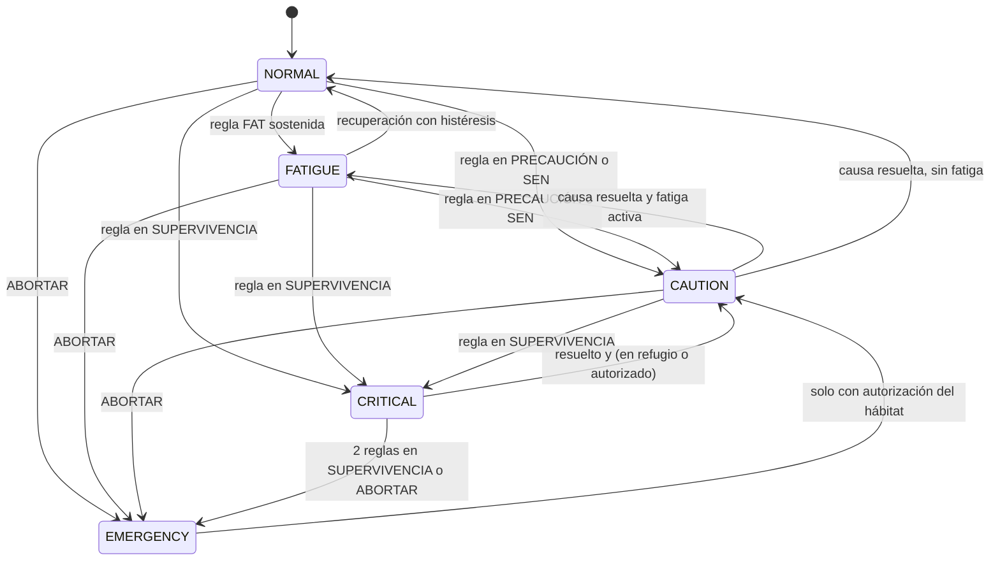

# ASTRONAUT_HEALTH_STATE_MACHINE — Estado de salud del astronauta

> Fase: PLANNING · Estado: propuesta para aprobación · Fecha: 2026-11-14
> Documento maestro: [MARS_TREK_MASTER_PLAN.md](../MARS_TREK_MASTER_PLAN.md) · Relacionados: [ROUTING_ALGORITHM.md](ROUTING_ALGORITHM.md), [RESOURCE_MANAGEMENT.md](RESOURCE_MANAGEMENT.md), [TESTING_STRATEGY.md](TESTING_STRATEGY.md)

> **Aviso.** Los estados de este documento son un modelo de diseño para un prototipo educativo de planificación. No son una clasificación médica ni reglas de vuelo. Ningún umbral debe usarse para decisiones clínicas reales.

---

## 1. Punto de partida: HUELLA

El equipo ya construyó un motor de reglas biomédicas, **HUELLA**, en `metricas de vida/huella_datos/`. La máquina de estados de Mars Trek se diseña **sobre** él, no al lado.

| Pieza existente | Archivo | Qué aporta |
| --- | --- | --- |
| Reglas de vuelo | `reglas.json` (v0.1-borrador) | 19 reglas previas a la EVA (PRE-01…19) y 21 durante la EVA (EVA-01…21), con origen declarado por regla |
| Motor de referencia | `motor_reglas.py` | Evaluación por segundo, niveles NORMAL < PRECAUCIÓN < SUPERVIVENCIA < ABORTAR, filtro de persistencia, modo regreso, regla de pareja |
| Generador de caminatas | `generar_caminata_sintetica.py` | Seis escenarios deterministas (semilla 42) con dos astronautas |
| Datos y resultados | `caminata_*_huella.csv`, `caminata_*_eventos.csv` | Telemetría sintética y las transiciones que produjo el motor |
| Conversor NASA SUITS | `convertir_a_huella.py` | Lee grabaciones del simulador TSS de NASA SUITS |
| Simulador visual | `simulador_huella.html` | Máquina de estados interactiva (ESTABLE / PRECAUCIÓN / SUPERVIVENCIA / ABORTAR) con candado de autorización |

Correspondencia entre los niveles de HUELLA y los estados pedidos para Mars Trek:

| Estado Mars Trek | Nivel HUELLA | Diferencia |
| --- | --- | --- |
| S1 NORMAL | NORMAL | Ninguna |
| S2 FATIGUE | — | **Nuevo.** HUELLA no distingue la fatiga: hoy cae en PRECAUCIÓN (regla EVA-07) |
| S3 CAUTION | PRECAUCIÓN | Ninguna |
| S4 CRITICAL | SUPERVIVENCIA | Ninguna; conserva el "modo regreso" |
| S5 EMERGENCY | ABORTAR | Ninguna; conserva el candado de autorización |

**Decisión D-H1.** El motor de reglas de HUELLA se porta a TypeScript sin cambiar su comportamiento, y las salidas del motor Python (`*_eventos.csv`) se usan como **archivos de referencia** para probar la paridad (prueba PT-09). Los seis escenarios existentes pasan a ser pruebas de aceptación.

---

## 2. Variables fisiológicas y operativas

Clasificación pedida: medible con sensor, estimada, o que requiere evaluación médica.

| Variable | Cómo se obtiene | Columna HUELLA | Observaciones |
| --- | --- | --- | --- |
| Frecuencia cardíaca | **Sensor** (ECG) | `heart_rate_bpm` | Presente en la telemetría de NASA SUITS |
| Ritmo irregular | **Sensor** más análisis | `rhythm_irregular` | El ECG crudo no entra en la telemetría; entra el resultado |
| Saturación de oxígeno | **Sensor** (oximetría) | `spo2_pct` | Con O₂ puro en el traje, una SpO₂ baja apunta casi siempre a fallo del traje |
| Frecuencia respiratoria | **Sensor** o derivada | `resp_rate_rpm` | Sube con el esfuerzo y con el CO₂ |
| Temperatura corporal central | **Sensor** (ingerible) o **estimada** | `core_temp_c` | Si es estimada, se etiqueta MODELLED |
| Gasto metabólico | **Medido en el traje** (consumo de O₂) o **estimado** por modelo | `metabolic_rate_kj_h` | NASA-STD-3001 Vol. 2 incluye requisitos de medición y visualización del gasto metabólico en EVA ([V2 11037], [V2 11038]) |
| Tiempo acumulado de actividad | **Medido** (reloj de misión) | `t_s` | |
| Exposición a radiación | **Sensor** (dosímetro personal) más modelo ambiental | `dose_eva_msv` | Dosis acumulada del tripulante; no confundir con la capa ambiental L08 |
| Presión, CO₂, O₂, ventilador, humedad, refrigeración, batería del traje | **Sensores del traje** | `suit_*`, `helmet_co2_mmhg`, `o2_*`, `fan_*`, `suit_humidity_pct`, `lcvg_inlet_temp_c`, `batt_*` | Ya modelados por HUELLA |
| Incertidumbre de posición | **Estimada** | `pos_uncertainty_m` | 1 m + 2 % de lo caminado **[diseño]** |
| Fatiga física | **Estimada** (índice) más autoinforme | — | Nueva; §5.2 |
| Capacidad de movilidad | **Estimada** (velocidad real frente a prevista) más autoinforme | — | Nueva; una lesión requiere evaluación médica |
| Nivel de hidratación | **Estimada** (ingesta frente a sudoración modelada) | — | Sin sensor directo en el traje; solo informativa hasta tener fuente (P-10) |
| Carga física transportada | **Declarada** en el plan | — | Masa de equipo y muestras |
| Síntomas, lesiones, aptitud | **Evaluación médica** o autoevaluación | Reglas PRE-04, PRE-05 | Antes de salir; no automatizable |
| Presión arterial | **Evaluación en el hábitat** | — | Decisión de HUELLA: solo en el hábitat |
| Fatiga de manos | **Autoevaluación** | — | Decisión de HUELLA: sin sensor |

Los datos biomédicos de trajes en EVA reales no son públicos; por eso HUELLA los simula. Mars Trek mantiene esa postura: **toda telemetría fisiológica del producto es simulada y se rotula como tal** (§10).

---

## 3. Umbrales y su procedencia

Regla de este documento: **no se inventan umbrales clínicos**. Cada valor tiene una de estas etiquetas:

- **Verificado**: comprobado en esta fase contra una fuente oficial.
- **Heredado**: viene de `reglas.json` con el origen que declaró el equipo; no se volvió a verificar aquí.
- **[diseño]**: parámetro del prototipo; no existe un dato público.

| Regla | Umbral | Etiqueta | Fuente |
| --- | --- | --- | --- |
| PRE-14 | Dosis de carrera < 600 mSv | **Verificado** | NASA-STD-3001 Vol. 1 [V1 4030]; resumen técnico [OCHMO-TB-020](https://www.nasa.gov/wp-content/uploads/2023/03/radiation-protection-technical-brief-ochmo.pdf) |
| PRE-14 | Precaución al 80 % (480 mSv) | [diseño] | Equipo |
| PRE-06 / EVA-13 | No hay EVA con evento de partículas solares; refugio | Heredado ("propuesto") | Contexto verificado: límite de diseño de 250 mSv por evento ([V1 4031]); el evento del 20 de mayo de 2024 dejó 8 100 µGy en superficie ([JPL](https://www.jpl.nasa.gov/news/nasa-watches-mars-light-up-during-epic-solar-storm)) |
| PRE-10 | Pendiente > 20° no-go | **Verificado** | Capacidad xEVA de hasta 20° ([EVA-EXP-0042](https://ntrs.nasa.gov/citations/20205008200)) |
| PRE-10 | Precaución > 15°, o > 10° con carga | [diseño] | Equipo |
| PRE-09 | Duración > 8 h no-go; > 6 h precaución | **Verificado** (rango) | EVA de hasta 8 h (6 ± 2 h) en el concepto de operaciones xEVA |
| Perfil | VO₂ pico ≥ 36.5 mL/kg/min | **Verificado** | NASA-STD-3001 Vol. 2 [V2 4015], citado en [NTRS 20230014953](https://ntrs.nasa.gov/citations/20230014953) |
| EVA-02 | Presión del traje ±0.69 / ±1.72 kPa | Heredado | Equipo cita NASA-STD-3001 Vol. 2 y EMU |
| EVA-04 | CO₂ en casco > 15 / > 20 mmHg | Heredado | Equipo cita NASA-STD-3001 Vol. 2. Existe el requisito [V2 11039] de niveles de CO₂ en traje; **falta cotejar la tabla** (P-11) |
| EVA-07 | FC > 90 % FCmáx 120 s; > 140 lpm 300 s | Heredado | Fisiología; FCmáx = 208 − 0.7·edad (Tanaka 2001) |
| EVA-08 | SpO₂ < 95 / < 90 / < 85 % | Heredado | "Rangos clínicos estándar" según el equipo |
| EVA-09 | T central ≥ 38.0 / 38.5 / 39.0 °C; < 35.5 / < 35.0 °C | Heredado | Fisiología y NASA según el equipo |
| EVA-10 | Índice de estrés fisiológico ≥ 7 / ≥ 9 | Heredado | Moran et al. (1998) |
| EVA-12 | Ritmo irregular; sostenido 60 s | Heredado ("propuesto") | Antecedente: arritmias en Apolo 15 |
| EVA-15 | Incertidumbre de posición > 50 / > 150 m | [diseño] | Equipo |
| EVA-16 | Más de 5 min sin comunicación | [diseño] | Equipo, por análogos |
| EVA-21 | Humedad del traje por rangos y tiempos | Heredado | Equipo cita rangos NASA |
| Filtro | Sube en 3 s, baja en 30 s | [diseño] | Equipo |

Contexto verificado útil para la fatiga (no son umbrales): en simulaciones de EVA de superficie se observaron cargas cercanas al 60 % del gasto metabólico máximo y al 85 % de la FC máxima prevista por edad ([NTRS 20230015332](https://ntrs.nasa.gov/citations/20230015332)); el rango de trabajo sostenible citado es 30–40 % del VO₂ pico ([NTRS 20230014953](https://ntrs.nasa.gov/citations/20230014953)). NASA lista como trabajo pendiente los requisitos de aptitud operativa y los intervalos trabajo–descanso para exploración: **no existe hoy un umbral oficial de fatiga en EVA**.

---

## 4. Arquitectura del módulo

```
 Telemetría (real o SIMULADA)
        │
        ▼
 1. Calidad de datos ──────► marca cada muestra: válida | antigua | ausente | implausible
        │
        ▼
 2. Variables derivadas ───► FC esperada, residuo de FC, índice de estrés, índice de fatiga,
        │                    márgenes de regreso (vienen de recursos)
        ▼
 3. Reglas (HUELLA + FAT + SEN) ─► nivel por regla
        │
        ▼
 4. Filtro de persistencia ─► nivel estable por regla (sube 3 s, baja 30 s)
        │
        ▼
 5. Agregación ────────────► severidad + banderas de causa
        │
        ▼
 6. Máquina de estados ────► S1…S5 con enclavamientos e histéresis
        │
        ▼
 7. Directiva de navegación ─► único canal hacia el motor de rutas
        │
        ▼
 8. Registro de transiciones (solo añadir)
```

**Independencia.** El módulo no importa nada del motor de rutas, del costmap ni de la interfaz. Su única salida hacia la navegación es la `NavigationDirective` (§7). El motor de rutas no puede leer telemetría ni reglas: solo la directiva.

---

## 5. Reglas

### 5.1 Reglas heredadas

Se conservan los identificadores y la lógica de `reglas.json`. Resumen de la lógica común:

- Gana el nivel más grave.
- **Dos o más reglas en SUPERVIVENCIA ⇒ ABORTAR.**
- Un dato ausente en una regla crítica cuenta como PRECAUCIÓN.
- Para bajar de nivel, la condición debe estar resuelta durante el tiempo de salida de la regla.
- Pareja (EVA-17): si un tripulante entra en emergencia, el otro regresa con él.

### 5.2 Reglas nuevas de fatiga (FAT)

Todas son **[diseño]**. La columna "Ancla" indica la evidencia que orienta el valor; el umbral exacto requiere validación médica (P-10).

| ID | Condición candidata | Ancla |
| --- | --- | --- |
| FAT-01 | % de VO₂ pico estimado por encima del rango sostenible durante ≥ 10 min | Rango sostenible 30–40 % VO₂ pico (NASA) |
| FAT-02 | Índice de estrés fisiológico en banda moderada (5–6) sostenido ≥ 5 min | Escala de Moran: 5–6 moderado; HUELLA alerta a partir de 7 |
| FAT-03 | Velocidad real < 70 % de la prevista en el tramo durante ≥ 5 min | Indicador de movilidad reducida |
| FAT-04 | Tiempo de EVA > 6 h | Duración nominal 6 ± 2 h |
| FAT-05 | Autoinforme de esfuerzo alto del tripulante | Escala subjetiva; no hay sensor |
| FAT-06 | Índice de fatiga acumulada `F` por encima del umbral de entrada | Modelo de §10.3, solo para simulación |

Salida de FATIGUE: todas las condiciones resueltas con umbral de salida **más bajo** que el de entrada (histéresis) durante el tiempo de salida. Un descanso acelera la salida.

### 5.3 Reglas de sensores y datos (SEN)

| ID | Condición | Efecto | Etiqueta |
| --- | --- | --- | --- |
| SEN-01 | Variable crítica sin actualizar > 10 s | La muestra pasa a "antigua"; las reglas que la usan cuentan como PRECAUCIÓN | [diseño], sobre la regla de dato faltante de HUELLA |
| SEN-02 | Valor fuera de rango físico o con salto imposible | Se descarta la muestra; sensor "sospechoso"; si persiste 30 s, "fallado" | [diseño] |
| SEN-03 | Dos fuentes de la misma variable discrepan | Se usa el valor más desfavorable | [diseño] |
| SEN-04 | Pérdida de toda la telemetría biomédica | CAUTION inmediato: **sin datos no es sano** | [diseño] |
| SEN-05 | Incertidumbre de posición > 50 m / > 150 m | CAUTION / CRITICAL | HUELLA EVA-15 |
| SEN-06 | Sin comunicación > 5 min | CAUTION; plan por defecto: volver al último punto de paso | HUELLA EVA-16 |

Reglas generales de datos:

- No se "congela" el último valor bueno más de 10 s. Pasado ese tiempo, la variable está ausente.
- Un sensor fallado **no** baja el estado. Solo puede mantenerlo o subirlo.
- El fallo de un sensor se registra como transición de calidad, aunque no cambie el estado.

---

## 6. Máquina de estados

### 6.1 Estados

| Estado | Significado | Efecto general en la navegación |
| --- | --- | --- |
| **S1 NORMAL** | Dentro de los parámetros operativos | Rutas convencionales; se optimiza tiempo, distancia y recursos |
| **S2 FATIGUE** | Fatiga o menor capacidad operativa, sin alerta fisiológica | Penaliza pendientes y exigencia; evalúa descansos |
| **S3 CAUTION** | Condición fisiológica o ambiental que pide precaución | Sube el peso de seguridad; reduce exposición; considera refugio |
| **S4 CRITICAL** | Condición que puede comprometer seriamente al astronauta | Suspende la planificación ordinaria; ruta a refugio; modo regreso |
| **S5 EMERGENCY** | Emergencia | Protocolo de emergencia; bloquea rutas que agraven el riesgo |

### 6.2 Severidad y causas

El estado es la **severidad máxima** activa. Además se mantiene un conjunto de **banderas de causa** (`fatiga`, `térmica`, `cardíaca`, `traje`, `ambiente`, `comunicaciones`, `radiación`, `navegación`, `sensores`). Las banderas determinan qué restricciones concretas lleva la directiva. Así, CAUTION por pérdida de comunicación y CAUTION por temperatura central elevada comparten estado pero no restricciones.

Agregación:

```
si hay alguna regla en ABORTAR o ≥ 2 reglas en SUPERVIVENCIA → S5
si no, si hay alguna regla en SUPERVIVENCIA                   → S4
si no, si hay alguna regla en PRECAUCIÓN (incluye SEN)        → S3
si no, si hay alguna regla FAT activa                         → S2
si no                                                         → S1
```

Si hay fatiga y además una causa de CAUTION, el estado es S3 y la bandera `fatiga` sigue activa: la directiva combina ambas restricciones.

### 6.3 Diagrama



### 6.4 Transiciones

| Tema | Regla |
| --- | --- |
| **Subida** | Inmediata en cuanto la severidad agregada, ya filtrada, supera el estado actual. Puede saltar niveles (NORMAL → EMERGENCY). |
| **Bajada** | **Un nivel cada vez.** CRITICAL nunca baja directo a NORMAL; pasa por CAUTION. |
| **Persistencia** | Filtro de HUELLA: una alerta sube si la condición dura 3 s y baja si lleva 30 s resuelta. Además, cada regla tiene su propio tiempo sostenido (120 s, 300 s, 60 s…). Todos **[diseño]**. |
| **Histéresis** | Umbral de salida distinto del de entrada donde la regla lo define (ejemplo de HUELLA: el residuo de FC entra a > 25 lpm y sale a < 15 lpm durante 60 s). |
| **Observación** | Tras salir de CRITICAL, permanencia mínima de 30 s en CAUTION antes de seguir bajando **[diseño]**. |
| **Enclavamiento en CRITICAL** | "Modo regreso": la EVA no se reanuda sola aunque el problema se resuelva. Solo baja a CAUTION al llegar a refugio o con autorización del hábitat. |
| **Enclavamiento en EMERGENCY** | Solo baja con autorización explícita del hábitat, y baja a CAUTION. |
| **Prioridad entre alertas** | Mayor severidad primero. A igual severidad, orden: traje y soporte vital, cardíaca, térmica, radiación, ambiente, navegación, comunicaciones, fatiga. El orden decide qué protocolo y qué mensaje van primero; no cambia el estado. |
| **Pareja** | Si un tripulante está en S4 o S5, la directiva del otro pasa a "regresar con el compañero" (HUELLA EVA-17). |

### 6.5 Registro histórico

Cada transición, de estado o de calidad de datos, añade un registro inmutable. El esquema amplía el de `*_eventos.csv` de HUELLA para poder comparar:

```ts
interface HealthTransition {
  seq: number; missionTimeS: number; subjectId: string;
  from: HealthState; to: HealthState;
  causes: CauseFlag[];
  triggers: { ruleId: string; level: string; value: number | string; message: string }[];
  dataQuality: Record<string, 'valid' | 'stale' | 'missing' | 'implausible'>;
  latch: 'none' | 'return-mode' | 'iv-lock';
  directiveId: string;        // directiva emitida a raíz de la transición
  simulated: boolean;         // true en todo el producto actual
  scenarioId?: string;
}
```

El registro se exporta en CSV y JSON y alimenta el informe de misión y la línea de tiempo de la interfaz.

---

## 7. Directiva de navegación

### 7.1 Contrato

```ts
interface NavigationDirective {
  directiveId: string; issuedAtS: number; supersedes?: string;
  subject: { kind: 'crew' | 'team' | 'vehicle'; id: string };
  state: HealthState; causes: CauseFlag[];
  goalPolicy: 'keep-goal' | 'nearest-safe-waypoint' | 'nearest-shelter' | 'hold-position';
  limits: {
    maxSlopeDeg: number;
    allowedZones: ZoneClass[];
    minConfidence: ConfidenceClass;
    maxDistanceToShelterM?: number;
    maxRemainingDurationMin?: number;
    speedFactor: number;                 // ≤ 1
    requiredRest?: { everyMin: number; durationMin: number };
    blockAggravating?: AggravationRule[]; // p. ej. no alejarse del refugio, no subir, no entrar en tormenta
  };
  weightMultipliers: Partial<Record<'t' | 'r' | 'e' | 'u' | 'h', number>>;  // todos ≥ 1
  strainFactor: number;                  // φ del término H, ≥ 1
  fallbackLadder: Array<Pick<NavigationDirective, 'limits' | 'goalPolicy'>>; // §7.3
  protocol?: EmergencyProtocolId;
  rationale: { ruleId: string; message: string }[];
  simulated: boolean;
}
```

### 7.2 Directiva por estado

Valores de partida, todos **[diseño]** salvo el límite de 20°. Los multiplicadores se aplican sobre el perfil base y luego se renormaliza.

| Estado | Pendiente máx. | Zonas | Multiplicadores | `φ` | Velocidad | Meta | Otros |
| --- | --- | --- | --- | --- | --- | --- | --- |
| NORMAL | 20° | Z0, Z1 (Z2 con aprobación) | ×1 | 1 | 1.0 | Se mantiene | — |
| FATIGUE | 15° | Z0, Z1 | `t`×2, `e`×1.5, `h`×3 | 2 | 0.8 | Se mantiene si el margen de regreso recalculado ≥ 20 %; si no, punto seguro más cercano | Evaluar zona de descanso cada 30 min |
| CAUTION (causa fisiológica) | 10° | Z0, Z1 | `t`×2, `r`×3, `u`×2, `h`×3 | 3 | 0.7 | Se mantiene solo si el margen lo permite; si no, punto seguro | Distancia máxima a refugio reducida |
| CAUTION (causa ambiental o de comunicaciones) | 15° | Z0, Z1 | `r`×3, `u`×2 | 1 | 1.0 | Último punto de paso o se mantiene, según la causa | Sin comunicación: volver al último punto de paso |
| CRITICAL | 15° con escalera | Z0, Z1 | Perfil de emergencia | — | La que permita el estado | **Refugio o punto de asistencia validado más cercano** | Planificación ordinaria suspendida; pareja regresa |
| EMERGENCY | Según protocolo | Z0, Z1 | Perfil de emergencia | — | Según protocolo | Según protocolo (§7.4) | Bloquea rutas que agraven el riesgo |

### 7.3 Escalera de degradación

Problema: en CRITICAL el límite de pendiente puede dejar sin ruta al refugio. El motor de rutas **no** puede decidir relajar un límite de salud. Solución: la propia directiva lleva una **escalera ordenada** de alternativas ya autorizadas por el módulo de salud:

1. Límites preferentes (los de la tabla).
2. Límites ampliados hasta el **límite absoluto del vehículo** (20° a pie), nunca más allá.
3. `hold-position`: quedarse en el punto más seguro alcanzable y solicitar rescate.

El motor prueba los peldaños en orden y devuelve cuál usó. La interfaz lo comunica ("ruta al refugio con pendiente de hasta 18°: por encima del límite preferente de 15°").

### 7.4 Protocolos de emergencia

El protocolo concreto es de la misión; aquí se define cómo se **selecciona** y qué pide a la navegación.

| Causa dominante | Meta | Qué se bloquea |
| --- | --- | --- |
| Evento de partículas solares | Refugio **blindado** más cercano (hábitat, rover presurizado, abrigo natural validado) | Rutas que aumenten el tiempo a cielo abierto |
| Fallo de traje o soporte vital (O₂ secundario en uso) | Volumen presurizado más cercano por la ruta más rápida admisible | Desvíos científicos y paradas |
| Estrés térmico o cardíaco | Refugio por la ruta de **menor exigencia** | Subidas evitables |
| Tormenta de polvo activa | Refugio más cercano fuera del polígono | Entrar o permanecer en la tormenta |
| Movilidad nula (lesión, incapacidad) | `hold-position` | Todo desplazamiento del afectado |

**Ruta de rescate inversa.** Con movilidad nula, el motor calcula la ruta **desde** el refugio o el rover **hasta** el afectado, con el perfil del rescatador (compañero a pie o rover).

---

## 8. Salud y planificación de rutas: el ejemplo

Ruta A: 5 km con pendiente considerable (tramos de 17°). Ruta B: 6 km con pendiente moderada (hasta 9°).

| Estado | Qué ocurre | Resultado |
| --- | --- | --- |
| NORMAL | Ambas dentro de la envolvente (≤ 20°). Se comparan por costo | Gana A o B según el perfil; con "equilibrado" gana A si su costo equivalente es menor |
| FATIGUE | El límite baja a 15°: los tramos de 17° de A quedan **fuera del grafo** | A deja de existir; B es la ruta |
| FATIGUE (variante) | Si A tuviera tramos de 14°, seguiría existiendo, pero `t`×2 y `h`×3 la encarecen | B pasa a ser la de menor costo |
| CRITICAL | `goalPolicy` cambia a refugio más cercano | Ni A ni B se evalúan: se calcula una ruta nueva a refugio |

Este ejemplo es la prueba de aceptación T-06.

---

## 9. Modos de misión

| Perfil | Quién emite la directiva | Particularidades |
| --- | --- | --- |
| Astronauta individual | Máquina de estados del tripulante | HUELLA prohíbe la EVA en solitario (PRE-03). El perfil existe para análisis y simulación y la interfaz lo advierte |
| Equipo de astronautas | Compositor de equipo | §9.1 |
| Rover autónomo | Monitor del vehículo con **el mismo contrato** | Estados equivalentes por energía, temperatura y deslizamiento; `w_h = 0`. Se especifica en H5 |
| Rover acompañado por astronautas | Compositor: vehículo ∩ tripulación | Límites del vehículo y de las personas a la vez; restricción de regreso a pie: siempre dentro del alcance a pie de un refugio |

### 9.1 Equipo

La misión tripulada se rige por **el integrante con más restricciones**, no por el promedio.

```
estado_equipo        = máximo de los estados individuales
límites_equipo       = lo más restrictivo de cada límite entre todos los miembros
velocidad_equipo     = la del miembro más lento
margen_regreso       = el del miembro con menor margen (y su consumible limitante)
multiplicadores      = el máximo de cada multiplicador
```

- Se conserva el estado individual de cada miembro para la interfaz y el registro.
- Regla de pareja: nadie regresa solo.
- La directiva de equipo indica qué miembro impone cada límite (campo `rationale`), para que la interfaz pueda decir "el límite de pendiente lo impone EV1".

---

## 10. Simulación

### 10.1 Objetivo

Demostrar que las rutas cambian con el estado del astronauta sin hardware médico.

### 10.2 Separación estricta de datos reales

| Medida | Detalle |
| --- | --- |
| Etiqueta | Toda muestra simulada lleva `dataType: 'SIMULATED'` y `simulated: true` hasta la directiva y el registro |
| Tipo | La telemetría simulada tiene un tipo distinto de una futura telemetría real; no se pueden mezclar por error de compilación |
| Interfaz | Banda permanente "SIMULACIÓN: no son datos fisiológicos reales" mientras haya una fuente simulada activa |
| Exportación | Los informes incluyen la fuente, el escenario y la semilla |
| Datos reales | Hoy no hay ninguno. Las grabaciones de NASA SUITS son telemetría de **simulador** y se rotulan como tales |

### 10.3 Escenarios

Heredados de HUELLA (deterministas, semilla 42):

| Escenario | Resultado esperado del motor |
| --- | --- |
| `nominal` | Cero alertas; el susto breve de EV1 no alerta |
| `falla_ventilador` | PRECAUCIÓN → SUPERVIVENCIA → ABORTAR |
| `fuga_traje` | PRECAUCIÓN → SUPERVIVENCIA; tanque secundario → ABORTAR |
| `estres_termico` | PRECAUCIÓN → SUPERVIVENCIA (modo regreso); después se recupera |
| `arritmia` | PRECAUCIÓN; sostenido 60 s → SUPERVIVENCIA |
| `perdida_comunicacion` | A los 5 min, PRECAUCIÓN: volver al último punto de paso |

Nuevos para Mars Trek:

| Escenario | Qué simula | Estado esperado |
| --- | --- | --- |
| `fatiga_progresiva` | Subida larga con carga; el índice de fatiga crece | NORMAL → FATIGUE |
| `recuperacion_descanso` | Parada en zona de descanso | FATIGUE → NORMAL con histéresis |
| `aumento_fc` | FC por encima de lo que explica el esfuerzo | CAUTION (regla EVA-06) |
| `movilidad_reducida` | Velocidad real muy por debajo de la prevista | FATIGUE; con movilidad nula, EMERGENCY y rescate inverso |
| `perdida_sensores` | Corte de telemetría biomédica | CAUTION por SEN-04 |
| `emergencia_medica` | Dos señales graves simultáneas | EMERGENCY |

### 10.4 Modelo de fatiga para simulación

Modelo simple, **[diseño]**, solo para generar escenarios; se etiqueta MODELLED:

```
F(t + Δt) = clamp( F(t) + Δt · [ a · max(0, M/M_sost − 1) − b · descanso ], 0, 1 )
```

`M` es el gasto metabólico del tramo, `M_sost` el sostenible del tripulante, `a` y `b` las tasas de acumulación y recuperación. No pretende predecir fatiga real.

Valores iniciales para FAT-06, todos **[diseño]**: entrada con `F ≥ 0.6` y salida con `F ≤ 0.4`. Las tasas `a` y `b` se ajustan en la tarea H5-4 para que el escenario `fatiga_progresiva` entre en FATIGUE durante la subida larga y `recuperacion_descanso` salga tras un descanso de duración razonable; los valores elegidos se anotan aquí.

### 10.5 Controles

Modo libre (deslizadores por variable y fallos, como en `simulador_huella.html`), modo escenario (reproducción determinista) y velocidad de simulación. Todo cambio pasa por el mismo camino que usaría la telemetría real: calidad → reglas → estado → directiva.

---

## 11. Garantías de seguridad

| ID | Garantía | Cómo se comprueba |
| --- | --- | --- |
| INV-H1 | El motor de rutas solo conoce la directiva, nunca la telemetría | Revisión de dependencias: `routing/` no importa `health/` salvo el tipo de la directiva |
| INV-H2 | La directiva solo puede **endurecer** los límites del perfil | `composeEnvelope()` toma lo más restrictivo; prueba PT-05 |
| INV-H3 | Sin directiva vigente no hay ruta | Tipo obligatorio; prueba PT-04 |
| INV-H4 | Un sensor fallado nunca baja el estado | Prueba de propiedad sobre SEN |
| INV-H5 | CRITICAL y EMERGENCY están enclavados | Pruebas T-07 y de escenario |
| INV-H6 | Las bajadas son de un nivel | Prueba de propiedad sobre secuencias aleatorias |
| INV-H7 | Nada simulado se presenta como real | Prueba de etiquetas de extremo a extremo |

---

## 12. Decisiones y pendientes

| ID | Tema | Estado |
| --- | --- | --- |
| D-H1 | Portar HUELLA a TypeScript con paridad contra los CSV de referencia | Propuesta |
| D-H2 | Cinco estados ordenados más banderas de causa | Propuesta |
| D-H3 | Directiva como único canal; escalera de degradación emitida por salud | Propuesta |
| D-H4 | Equipo regido por el miembro más restrictivo | Propuesta |
| P-10 | Umbrales FAT e hidratación: requieren revisión médica | Pendiente |
| P-11 | Cotejar CO₂ y presión del traje con las tablas de NASA-STD-3001 Vol. 2 | Pendiente |
| P-12 | Hay dos copias de `motor_reglas.py` y `generar_caminata_sintetica.py` con contenido distinto (raíz de `metricas de vida/` y `huella_datos/`). Se toma `huella_datos/` como referencia por ser la más completa (incluye humedad, comunicaciones y los seis escenarios) y la que coincide con la documentación de 155 líneas | **Pendiente de confirmar por el usuario** |
| P-13 | Quién "autoriza" en el producto (rol del hábitat) y cómo se simula | Pendiente de UX |

## 13. Referencias

- NASA-STD-3001 Vol. 1 y Vol. 2; resúmenes técnicos OCHMO: radiación [TB-020](https://www.nasa.gov/wp-content/uploads/2023/03/radiation-protection-technical-brief-ochmo.pdf), CO₂ [TB-004](https://www.nasa.gov/wp-content/uploads/2023/12/ochmo-tb-004-carbon-dioxide.pdf); Vol. 2 cap. 11, trajes: <https://www.nasa.gov/reference/11-0-spacesuits-vol-2/>
- NASA (2020). *Exploration EVA System Concept of Operations*, EVA-EXP-0042. <https://ntrs.nasa.gov/citations/20205008200>
- NASA HRP. *Evidence Report: Risk of Injury and Compromised Performance due to EVA Operations*. <https://ntrs.nasa.gov/citations/20220004017>
- NASA HRP. *Risk of Performance Decrements and Adverse Health Outcomes Resulting from Sleep Loss, Circadian Desynchronization, and Work Overload*. <https://ntrs.nasa.gov/api/citations/20150016964/downloads/20150016964.pdf>
- NASA. *Considerations for Health and Performance During Surface Extravehicular Activities*. <https://ntrs.nasa.gov/citations/20230015332>
- NASA. *Evaluation of Aerobic Capacity in Relation to Simulated Lunar Surface EVA*. <https://ntrs.nasa.gov/citations/20230014953>
- JPL (2024). *NASA Watches Mars Light Up During Epic Solar Storm*. <https://www.jpl.nasa.gov/news/nasa-watches-mars-light-up-during-epic-solar-storm>
- Moran, D., Shitzer, A., Pandolf, K. (1998). *A physiological strain index to evaluate heat stress*. Am J Physiol 275.
- Tanaka, H., Monahan, K., Seals, D. (2001). *Age-predicted maximal heart rate revisited*. J Am Coll Cardiol 37(1).
- Swain, D., Leutholtz, B. (1997). *Heart rate reserve is equivalent to %VO₂ reserve*. Med Sci Sports Exerc 29(3).
- Documentación del equipo: `metricas de vida/huella_datos/DOCUMENTACION_caminata_sintetica.md` y `reglas.json`.
