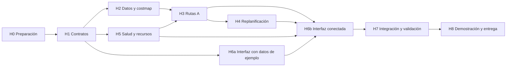

> Fase: **BUILD (Corte Mínimo Completado)** · Fecha: 2026-11-15
> Documento maestro: [MARS_TREK_MASTER_PLAN.md](../MARS_TREK_MASTER_PLAN.md) · Relacionados: [AGENT_GUIDELINES.md](AGENT_GUIDELINES.md), [TESTING_STRATEGY.md](TESTING_STRATEGY.md), [2026-11-15-corte-minimo-ledger.md](plans/2026-11-15-corte-minimo-ledger.md)

> **Estado actual:** El corte mínimo demostrable (Tareas 1 a 12 de `docs/plans/2026-11-15-corte-minimo.md`) está implementado y verificado en `Nasa-Space-App-challange-2026/` con **30 suites de pruebas en verde (199 pruebas totales: 150 de línea base + 49 nuevas de Mars Trek)**. Rutas activas: `/trek` y `/martian-map`.

---

## 1. Estado de PLANNING

| # | Criterio de finalización | Estado | Evidencia |
| --- | --- | --- | --- |
| 1 | Repositorio auditado | Hecho | MASTER_PLAN §3 |
| 2 | Documentación técnica principal analizada | Hecho | MASTER_PLAN §3.6; DATA_SOURCES §7 |
| 3 | Fuentes científicas verificadas | Hecho, con pendientes señalados | DATA_SOURCES §1–§6, P-16 |
| 4 | Arquitectura definida | Hecho | ARCHITECTURE |
| 5 | Modelo de costos diseñado | Hecho | ROUTING_ALGORITHM §3–§4 |
| 6 | Estrategia de A\* y replanificación definida | Hecho | ROUTING_ALGORITHM §6 |
| 7 | Costmap multicapa especificado | Hecho | DYNAMIC_COSTMAP |
| 8 | Máquina de estados de salud diseñada | Hecho | ASTRONAUT_HEALTH_STATE_MACHINE |
| 9 | Gestión de recursos documentada | Hecho | RESOURCE_MANAGEMENT |
| 10 | Restricciones de seguridad definidas | Hecho | ROUTING_ALGORITHM §5; DYNAMIC_COSTMAP §7 |
| 11 | Hoja de ruta dividida en tareas verificables | Hecho | Este documento |
| 12 | Documentos guardados y vinculados | Hecho | Enlaces comprobados |
| 13 | Otro agente puede incorporarse sin esta conversación | Hecho | AGENT_GUIDELINES |

---

## 2. Decisiones que necesita el usuario antes de BUILD

Sin estas respuestas, BUILD arrancaría con suposiciones. Cada una tiene una recomendación.

| ID | Decisión | Recomendación | Qué cambia |
| --- | --- | --- | --- |
| P-01 | ¿Dónde vive la documentación en git? Hoy está en la raíz de la carpeta de trabajo, que no es un repositorio | Moverla al repositorio principal en `docs/mars-trek/` y confirmarla | Rutas de los enlaces y quién la ve al clonar |
| P-02 | Sitio piloto | **Gale primero** (ya hay mallas, travesías e imagen de alta resolución integradas); Jezero después | Qué datos se descargan en H2 |
| P-03 | Relación con el sitio Space Rockstars (`Nasa/`) y su sección MarsWalk | Enlazar desde MarsWalk a `/trek`; no duplicar el planificador | Alcance del frontend |
| P-04 | Límite de pendiente a pie: 20° (HUELLA, xEVA) o 25° (planificador actual) | **20°** en Mars Trek; no tocar el planificador actual | Zonas y rutas |
| P-05 | Velocidad en llano: 2 km/h o 3 km/h | Decidir con la fuente que usó el equipo para 2 km/h | Tiempos y consumos |
| P-08 | ¿Una emergencia puede cruzar zonas restringidas? | No de forma automática; solo con confirmación registrada | Protocolo de emergencia |
| P-12 | Copia de referencia de HUELLA: hay dos versiones distintas del motor | La de `huella_datos/`, que es la más completa | Contra qué se prueba la paridad |
| P-19 | Idioma de la interfaz | Español e inglés con textos centralizados | Trabajo de frontend |
| P-20 | Nombre visible: "Mars Trek" es también el portal de NASA | Mantener el nombre interno y añadir un distintivo, o usar "MarsWalk" | Marca y textos |
| P-21 | Instalar las skills de UX en el repositorio | Sí, a nivel de proyecto y con revisión fijada | Preparación de H0 |
| P-23 | Fecha de entrega y número de personas y agentes | — | Dónde se corta el alcance (§4) |

---

## 3. Hitos

Las dependencias entre hitos permiten trabajar en paralelo después de H1.

Tamaño: **P** pequeño, **M** mediano, **G** grande. Agentes: A1 cartografía, A2 datos, A3 navegación, A4 salud, A5 recursos, A6 frontend, A7 integración.

### H0 · Preparación

| ID | Tarea | Agente | Verificación |
| --- | --- | --- | --- |
| H0-1 | Resolver las decisiones de §2 y registrarlas | Usuario + A7 | Registro de decisiones actualizado |
| H0-2 | Confirmar en git el trabajo sin confirmar del repositorio principal (5 archivos modificados y 25 sin seguimiento) antes de crear la rama | Usuario | `git status` limpio |
| H0-3 | Rama `feature/mars-trek` desde `feature/intelligent-mission-control` | A7 | Rama creada; el proyecto está conectado a Lovable: no reescribir historia publicada |
| H0-4 | Instalar dependencias en la máquina del usuario y repetir la línea base | A7 | 150 pruebas en verde; `tsc` sin errores |
| H0-5 | Instalar las skills de UX aprobadas con revisión fijada | A6 | Lista de skills y revisiones en AGENT_GUIDELINES |
| H0-6 | Guardar instantáneas de datos (`npm run data:fetch`) | A2 | `public/data/nasa/manifest.json` presente |
| H0-7 | Mover la documentación si se decide P-01 | A7 | Enlaces comprobados |

### H1 · Contratos y esqueleto · tamaño M

| ID | Tarea | Agente | Depende de | Verificación |
| --- | --- | --- | --- | --- |
| H1-1 | Tipos de `src/core/trek/contracts/` según ARCHITECTURE §5 | A7 | H0 | `tsc` sin errores; revisión de A1–A6 |
| H1-2 | Esqueleto de módulos con sus límites de importación | A7 | H1-1 | Prueba de dependencias: `routing` no importa `health` |
| H1-3 | Bus de eventos y reloj de misión | A7 | H1-1 | Unitarias |
| H1-4 | Formato de guion de escenario y dos guiones de ejemplo | A7 | H1-1 | Validación de esquema |
| H1-5 | Rejillas sintéticas: dos corredores, franja desconocida | A3 | H1-1 | Disponibles para T-02 y T-06 |
| H1-6 | Generadores de propiedad sobre `rng.ts` | A7 | H1-1 | Deterministas con semilla |
| H1-7 | **Congelar contratos** | A7 | H1-1…6 | Registro de decisión; cambios posteriores solo por solicitud |

### H2 · Datos y costmap · tamaño G

| ID | Tarea | Agente | Depende de | Verificación |
| --- | --- | --- | --- | --- |
| H2-1 | Completar las verificaciones pendientes de fuentes (P-16) con peticiones reales | A2 | H0 | DATA_SOURCES actualizado, sin entradas "pendiente" en lo que se use |
| H2-2 | Pipeline fuera de línea: descarga, recorte, reproyección con `IAU_2015`, manifiesto | A2 | H2-1 | Sumas de comprobación; rangos físicos |
| H2-3 | Elevación y pendiente del sitio piloto en nivel N3 | A1 | H2-2 | Pendiente con línea base declarada |
| H2-4 | Rugosidad, firmeza y obstáculos | A1 | H2-3 | Unitarias; procedencia |
| H2-5 | Travesías como clase K1; huellas de Access Mars como K2 | A2 | H2-2 | Corredores coinciden con MMGIS |
| H2-6 | Clases y puntuación de confianza | A2 | H2-3, H2-5 | Unitarias; experimentos de SCIENTIFIC_CONFIDENCE §8 |
| H2-7 | Clasificación de zonas | A1 | H2-3, H2-6 | Unitarias por regla ZN |
| H2-8 | Teselas, instantáneas, versiones, regiones sucias | A1 | H1 | Unitarias |
| H2-9 | Almacenamiento en IndexedDB | A1 | H2-8 | Prueba de carga y purga |
| H2-10 | Capas dinámicas desde guion: tormenta, alerta, luz | A1 | H1-3, H2-8 | Unitarias |

### H3 · Rutas A: A\* multicapa · tamaño G

| ID | Tarea | Agente | Depende de | Verificación |
| --- | --- | --- | --- | --- |
| H3-1 | Términos de costo y validación de pesos | A3 | H1 | PT-15; unitarias por término |
| H3-2 | Perfiles de pesos y multiplicadores | A3 | H3-1 | Unitarias |
| H3-3 | Envolvente de seguridad y `validateRoute` | A3 | H1 | PT-04, PT-05 |
| H3-4 | A\* multicapa sobre grafo dirigido | A3 | H3-1, H3-3 | PT-01, PT-02, PT-07 |
| H3-5 | Equivalencia con `findSafePath` | A3 | H3-4 | PT-08 |
| H3-6 | Suavizado y segmentación | A3 | H3-4 | PT-06 |
| H3-7 | Explicación: contribuciones, bloqueo del camino directo | A3 | H3-4 | T-02, T-10 |
| H3-8 | Alternativas por intención | A3 | H3-4 | T-06 en NORMAL |
| H3-9 | Búsqueda jerárquica regional y local | A3 | H3-4, H2-3 | Unitarias; rótulo de escala |
| H3-10 | Planificador en Web Worker | A3 con A6 | H3-4 | Banco de rendimiento |
| H3-11 | Calibración de `k`, `κ` y perfiles en el sitio piloto | A3 | H2, H3-4 | Informe de calibración (P-07) |

### H4 · Rutas B: replanificación · tamaño G

| ID | Tarea | Agente | Depende de | Verificación |
| --- | --- | --- | --- | --- |
| H4-1 | Controlador de eventos y clasificación de cambios | A3 | H3 | Unitarias por tipo de evento |
| H4-2 | Revalidación y regla de estabilidad | A3 | H4-1 | T-03 (parte de costo), T-09 |
| H4-3 | D\* Lite | A3 | H3-4 | **PT-03** |
| H4-4 | Búsqueda multi-meta anytime hacia refugios | A3 | H3-4 | PT-13; T-07 |
| H4-5 | Escalera de degradación | A3 con A4 | H4-4, H5-5 | Unitarias |
| H4-6 | Ruta de rescate inversa | A3 | H4-4 | Escenario de movilidad nula |
| H4-7 | Medición frente a presupuestos; decidir si hace falta AD\* | A3 | H4-3, H4-4 | Informe de rendimiento |

### H5 · Salud y recursos · tamaño G, en paralelo con H2–H4

| ID | Tarea | Agente | Depende de | Verificación |
| --- | --- | --- | --- | --- |
| H5-1 | Confirmar la copia de referencia de HUELLA (P-12) | A4 | H0 | Registro |
| H5-2 | Port de reglas y filtro de persistencia a TypeScript | A4 | H1 | **PT-09** con los seis CSV |
| H5-3 | Calidad de datos y reglas SEN | A4 | H5-2 | T-08; PT-11 |
| H5-4 | Reglas FAT e índice de fatiga | A4 | H5-2 | Unitarias; etiquetas de diseño |
| H5-5 | Máquina de estados y directiva | A4 | H5-2…4 | PT-11; T-07 |
| H5-6 | Compositor de equipo | A4 | H5-5 | T-12 |
| H5-7 | Simulador de telemetría y guiones nuevos | A4 | H5-5 | Deterministas; PT-12 |
| H5-8 | Modelos de locomoción (dos implementaciones) | A5 | H1 | Unitarias; comparación documentada |
| H5-9 | Consumo de O₂, CO₂, refrigeración y batería | A5 | H5-8 | Unitarias |
| H5-10 | Modelo de energía del rover y perfiles de vehículo | A5 | H1 | Unitarias; fuentes de parámetros |
| H5-11 | Presupuestos, reservas y márgenes | A5 | H5-9 | Unitarias |
| H5-12 | Envolvente de alcanzabilidad | A5 con A3 | H5-11, H3-4 | PT-14; T-05 |
| H5-13 | Cotejar umbrales pendientes con NASA-STD-3001 (P-11) | A4 | — | Documento actualizado |

### H6 · Interfaz · tamaño G

| ID | Tarea | Agente | Depende de | Verificación |
| --- | --- | --- | --- | --- |
| H6-1 | `PRODUCT.md` y `DESIGN.md` desde el encargo | A6 | H0-5 | Revisión del usuario |
| H6-2 | Maquetas: pantalla principal y vista de emergencia | A6 | H6-1 | **Aprobación del usuario** |
| H6-3 | Ruta `/trek`, disposición y store, con datos de ejemplo | A6 | H1 | Sin errores de consola |
| H6-4 | Mapa del sitio con capas, leyendas y ficha de evidencia | A6 | H6-3, H2 | Prueba de extremo a extremo |
| H6-5 | Ficha de ruta, barra de porqués y comparación | A6 | H3-7, H3-8 | T-06 visible |
| H6-6 | Panel de salud, directiva y equipo | A6 | H5-5 | T-12 visible |
| H6-7 | Consola de simulación y línea de tiempo | A6 | H1-3, H5-7 | Banda de simulación |
| H6-8 | Visualización de replanificación | A6 | H4 | T-03 visible |
| H6-9 | Capa de alcance y punto de no retorno | A6 | H5-12 | T-05 visible |
| H6-10 | Vista 3D del sitio con costmap y ruta | A6 | H6-4 | Rendimiento; sin WebGL |
| H6-11 | Vista de campo en tableta y móvil | A6 | H6-5 | Táctil; áreas seguras |
| H6-12 | Revisión de diseño completa | A6 | H6-3…11 | Lista de UX_UI_GUIDELINES §8 |

### H7 · Integración y validación · tamaño M

| ID | Tarea | Agente | Verificación |
| --- | --- | --- | --- |
| H7-1 | Los doce escenarios T-01…T-12 de extremo a extremo | A7 | Todos en verde |
| H7-2 | Banco de rendimiento | A7 | Presupuestos cumplidos o desviación documentada |
| H7-3 | Auditoría de honestidad de datos | A7 con A2 | PT-12; ningún valor sin procedencia |
| H7-4 | Puente con el planificador y el simulador de misión (`setEvaPlan`) | A7 | Una ruta de Mars Trek llega al simulador |
| H7-5 | Revisión de seguridad: ninguna ruta evita la envolvente | A7 | PT-04 con diez mil casos |
| H7-6 | Documentación actualizada | Todos | Enlaces comprobados |

### H8 · Demostración y entrega · tamaño P

| ID | Tarea | Agente | Verificación |
| --- | --- | --- | --- |
| H8-1 | Guion de demostración con tres escenarios | A7 | Reproducible con semilla |
| H8-2 | Despliegue (configuración de Netlify existente) con instantáneas incluidas | A7 | Funciona sin red a NASA |
| H8-3 | Enlace desde el sitio de presentación | A6 | Según P-03 |
| H8-4 | Declaración de uso de inteligencia artificial para Space Apps | Usuario | Campo de la entrega |
| H8-5 | Créditos y licencias de datos | A2 | Lista completa en la aplicación |

---

## 4. Corte mínimo demostrable

Si el tiempo es corto (P-23), este corte demuestra la tesis central del producto: **la ruta cambia con el estado del astronauta y lo explica**. Todo lo demás es ampliación.

| Incluye | Tareas |
| --- | --- |
| Un sitio: una escena de Gale con la malla ya integrada | H2-3, H2-7 reducidas a pendiente y zonas |
| A\* multicapa con envolvente y explicación | H1, H3-1…H3-7 |
| Replanificación volviendo a ejecutar A\* (sin D\* Lite) | H4-1, H4-2 |
| Salud: port de HUELLA, máquina de estados, tres escenarios (nominal, fatiga, crítico) | H5-2, H5-4, H5-5, H5-7 |
| Recursos: solo margen de regreso de O₂ | H5-8, H5-9, H5-11 |
| Interfaz: mapa, ruta, barra de porqués, panel de salud, controles de simulación | H6-3, H6-4, H6-5, H6-6, H6-7 |
| Pruebas: T-06, T-07, T-10; PT-01, PT-02, PT-04, PT-09 | H7-1 parcial |

Queda fuera del corte y entra después, por este orden: D\* Lite y anytime (H4-3, H4-4); confianza completa (H2-5, H2-6); alcanzabilidad (H5-12); equipo (H5-6); vista 3D y de campo (H6-10, H6-11); segundo sitio.

---

## 5. Riesgos para el plan

| Riesgo | Efecto | Mitigación |
| --- | --- | --- |
| Datos de alta resolución escasos o pesados | H2 se alarga | Empezar con la malla de Access Mars ya integrada; DTM después |
| Trabajo sin confirmar en el repositorio | Conflictos al crear la rama | H0-2 antes de todo |
| Contratos que cambian tarde | Retrabajo entre agentes | Congelación en H1-7 y solicitud formal de cambio |
| D\* Lite con errores sutiles | Rutas subóptimas sin aviso | PT-03 contra A\* como oráculo; el corte mínimo no depende de D\* Lite |
| Umbrales de salud discutibles | Pérdida de credibilidad | Etiquetas de procedencia en todo; revisión P-10 y P-11 |
| Rendimiento en navegador | Replanificación lenta | Worker, búsqueda jerárquica, ventanas acotadas; medición temprana en H3-10 |
| Conexión con Lovable | Pérdida de historial si se reescribe | Nunca forzar el envío ni reescribir confirmaciones publicadas |
| Varios agentes en paralelo | Soluciones incompatibles | Un propietario por directorio (AGENT_GUIDELINES §4) |
